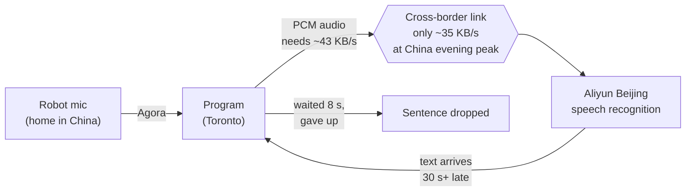
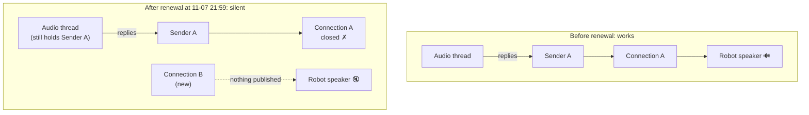

# 机器人"不说话"事件复盘（2026-11-08） Incident review: the robot that "stopped talking" (2026-11-08)

家里人只说了一句"机器人不说话"，背后其实是**两个不相干的故障叠在了一起**。第一个很显眼，看板上全是报错；第二个藏得很深，看板上一切正常，但家里人就是听不到声音。

My family said just one thing: "the robot isn't talking." Behind it were **two unrelated faults stacked on top of each other**. The first was obvious: the dashboard was full of errors. The second was well hidden: the dashboard looked perfectly fine, but my family simply couldn't hear anything.

| | 第一轮 Round 1 | 第二轮 Round 2 |
|---|---|---|
| 表现 Symptom | 妈妈说的话被扔掉，机器人不回   What Mom said was thrown away; no reply | 机器人回了（看板上有文字），但没声音   It replied (text on the dashboard), but no sound |
| 看板 Dashboard | 满屏报错   Full of errors | 一切正常   Everything looked fine |
| 原因 Cause | 跨境上传太慢，语音识别跟不上   Cross-border upload too slow for speech recognition | 凭证续期后，声音推进了已经断开的旧连接   After a credential renewal, audio went into the old, closed connection |
| 修复 Fix | 声音压缩成 Opus 再发   Compress audio to Opus | 续期前先停掉旧的推声音线程   Stop the old audio thread before renewing |

---

## 时间线 / Timeline

多伦多是跑程序的电脑所在地；机器人在国内，北京时间比多伦多早 13 小时。 Toronto is where the program runs; the robot is in China, 13 hours ahead of Toronto.

| 多伦多 Toronto | 北京 Beijing | 发生了什么 / What happened |
|---|---|---|
| 11-07 21:59 | 11-08 10:59 | 声网凭证自动续期。**从这一刻起机器人没有声音了**，但当时没人发现。 Agora credentials renewed automatically. **From this moment the robot had no sound**, but nobody noticed yet. |
| 11-08 04:00 起 | 17:00 起 | 国内晚高峰，跨境上传变慢，大量句子被扔掉。 China's evening peak: cross-border upload slows down and many sentences get dropped. |
| 09:09 | 22:09 | 妈妈："你咋不说话了呢？"   Mom: "Why aren't you talking?" |
| 10:22 | 23:22 | 妈妈："告诉你姐姐你小人不说话。"   Mom: "Tell your sister the little guy won't talk." |
| 10:28 | 23:28 | 开始排查第一轮。 Round 1 investigation starts. |
| 10:44 | 23:44 | Opus 修复上线。 Opus fix deployed. |
| 11:12–11:18 | 00:12–00:18 | 看板上能看到机器人的文字回复了，但家里人听不到。 Text replies show on the dashboard, but the family hears nothing. |
| 11:19 | 00:19 | 开始排查第二轮。 Round 2 investigation starts. |
| 11:24 | 00:24 | Engine 修复上线并重启。 Engine fix deployed and restarted. |
| 11:28 左右 / about 11:28 | 00:28 | 人工去听，能听到回答了。 Checked by ear: the answer is audible again. |

机器人一共哑了大约 **13 个半小时**（11-07 21:59 到 11-08 11:24）。

The robot was mute for about **13.5 hours** (11-07 21:59 to 11-08 11:24).

---

## 第一轮：语音识别跟不上 / Round 1: speech recognition couldn't keep up

### 现象 / What we saw

看板的日志里一直在刷 `No transcript within 8s; ignoring turn`，意思是"等了 8 秒还没拿到这句话的文字，当作没人说话"。妈妈说的话几乎全被扔掉了。

The dashboard log kept repeating `No transcript within 8s; ignoring turn`, meaning "no text for this sentence after 8 seconds, so treat it as if nobody spoke." Almost everything Mom said was thrown away.

### 原因 / Cause

备注：同一时间，这台电脑往国外服务器传数据有 2.4 MB/s，往阿里云北京只有约 35 KB/s，所以是跨境这段堵，不是家里网络的问题。 Note: at the same time, uploads from this computer to a non-China server ran at 2.4 MB/s, but only about 35 KB/s to Aliyun Beijing, so the bottleneck was the cross-border link, not the home internet.

每说一句话，程序要一边听一边把声音传到北京的阿里云转成文字。国内晚上跨境线路拥堵，上传只剩大约 35 KB/s，但原来的格式每秒要传大约 43 KB。好比水管每秒只能流 35 升，却每秒倒进 43 升，水只会越积越多。识别结果越回越晚，最后晚了 30 多秒，程序等 8 秒没等到，就把这句话扔了。

For every sentence, the program streams the audio to Aliyun in Beijing to be turned into text. In the Chinese evening the cross-border link gets congested and upload drops to about 35 KB/s, while the old format needed about 43 KB every second. It's like a pipe that can carry 35 liters a second while you pour in 43: the water just keeps piling up. Results came back later and later, eventually more than 30 seconds late. The program waited 8 seconds, got nothing, and dropped the sentence.

这个问题其实不完全"明显"。翻日志发现，10-27、10-28、10-30、11-02 这几天延迟也很高，很可能是同样的拥堵，只是没严重到刷屏。而且程序原本有个保护："发送积压满了就断线重连"，但它只看得到程序自己的小队列，看不到真正卡住的网络那一段，所以一直没报警。

This problem wasn't entirely "obvious" either. The logs show high latency on 10-27, 10-28, 10-30 and 11-02 too, most likely the same congestion, just not bad enough to flood the screen. The program also had a safeguard ("if the send backlog fills up, reconnect"), but it only saw the program's own small queue, not the network part that was actually stuck, so it never raised an alarm.

### 修复 / Fix

把声音先压缩成 Opus 再发。数据量只有原来的约 9%，识别出来的文字一字不差。连续推 90 秒音频测试：原来延迟最长 26 秒、中途断线；改完以后每句都在 2 秒内回来。

Compress the audio to Opus before sending it. It's about 9% of the original size, and the recognized text is word-for-word the same. In a 90-second nonstop test, the old way peaked at 26 seconds of delay and dropped the connection midway; after the change every sentence came back within 2 seconds.

试的过程中踩到两个文档没写的坑：阿里云只认装进 Ogg 格式里的 Opus（直接发 Opus 数据会报错）；而且一条连接从头到尾只能是同一个 Ogg 流，每句话重新开一个流的话，从第二句起就全部报错。

Testing turned up two things the docs don't mention: Aliyun only accepts Opus wrapped in the Ogg format (raw Opus data is rejected), and one connection must carry a single Ogg stream from start to finish; starting a new stream per sentence fails from the second sentence on.

<b>名词 / Terms</b> 
PCM：没压缩的原始声音数据。/ Raw, uncompressed audio data. 
Opus：一种声音压缩格式，网络通话常用，体积小、音质好。/ An audio compression format common in online calls: small and good quality. 
Ogg：一种"包装盒"格式，把 Opus 数据按规矩装起来。/ A "container" format that packages Opus data in a standard way. 
语音识别 / speech recognition (ASR)：把声音转成文字。/ Turning speech into text. 
上传 / upload：从这台电脑往外发数据的方向。/ Data going out from this computer.

---

## 第二轮：有文字、没声音 / Round 2: text, but no sound

### 现象：一切看起来都正常 / What we saw: everything looked normal

第一轮修好以后，妈妈说的话又能被识别了，看板上也出现了机器人的文字回复。可家里人说还是听不到声音。这时候能看到的每一项指标都是正常的：

After Round 1 was fixed, Mom's words were recognized again and the robot's text replies appeared on the dashboard. But my family said they still couldn't hear it. Every signal we could see said things were fine:

- 程序日志：每句回复都写着 `streamed 3.0s reply to EBO speaker (2980 ms played)`。 Program log: every reply said `streamed 3.0s reply to EBO speaker (2980 ms played)`.
- Engine 日志：每句都写着 `[talk-stream] done — 2980 ms played`。 Engine log: every reply said `[talk-stream] done — 2980 ms played`.
- 机器人音量 100，麦克风正常，看板健康检查全绿。 Robot volume at 100, microphone working, dashboard health checks all green.

### 怎么找到的 / How it was found

1. **先分段。** 程序说"已经交给 Engine"，Engine 说"已经播完"，那问题就在 Engine 之后：Engine → 声网 → 机器人喇叭。 **Split the path first.** The program said "handed to the Engine" and the Engine said "finished playing", so the problem was after the Engine: Engine → Agora → robot speaker.
2. **排除干扰项。** 声网每隔 10 秒报一次"网络拥塞，音频卡住"，看起来很可疑。但一对比，昨天正常的时候这个数也一样多，所以不是它。 **Rule out red herrings.** Agora reported "audio frozen due to network congestion" every 10 seconds, which looked suspicious. But the count was just as high yesterday when everything worked, so it wasn't the cause.
3. **找"最后一次正常"。** 翻 Engine 日志往回找，11-07 21:59:47 还在正常播放，紧接着 21:59:57 出现一行 `Agora session renewed (auto)`（声网凭证自动续期）。续期以后，日志里再也没有出现 `[audio-tx] publishing our audio track`（"开始发布我们的声音"）这一行。 **Find "the last time it worked".** Going back through the Engine log, playback was normal at 11-07 21:59:47, followed at 21:59:57 by `Agora session renewed (auto)`. After the renewal, the line `[audio-tx] publishing our audio track` never appeared again.
4. **对代码。** Engine 里有两条"断开再重连"的路径。唤醒机器人那条会先停掉旧的推声音线程，代码里还专门写了注释提醒；凭证续期那条漏了这一步。 **Check the code.** The Engine has two "disconnect and reconnect" paths. The wake-up path stops the old audio thread first, with a comment explaining why; the credential-renewal path skipped that step.

### 原因 / Cause

备注：日志里的 "N ms played" 只是"交给 Sender A 了多少"。往已经断开的连接里交声音不会报错，所以日志照样显示播放成功。 Note: "N ms played" in the logs only counts how much was handed to Sender A. Handing audio to a closed connection raises no error, so the log still showed a successful playback.

声网的通话凭证大约 24 小时过期，Engine 每 20 小时自动续一次。续的时候先断开旧连接，再用新凭证建一条新连接。

Agora call credentials expire after about 24 hours, so the Engine renews them every 20 hours. Renewing means closing the old connection and opening a new one with the new credentials.

问题是负责推声音的那个线程，手里一直拿着旧连接的"发送口"。续期时没有把它停掉，它就继续往旧连接里推声音，不报错。新连接那边，程序以为"已经有线程在推了"，就没有再发布我们的声音。结果每句回复都推进了一个已经不存在的连接，日志写着"播放成功"，机器人一点声音都没有。

The problem was that the thread pushing audio was still holding the old connection's "sender". The renewal didn't stop it, so it kept pushing audio into the old connection without any error. On the new connection, the program thought "a thread is already pushing audio" and never published our audio again. Every reply went into a connection that no longer existed; the log said "played successfully", and the robot made no sound at all.

为什么以前没发现？续期每 20 小时就有一次。翻了 10-22 以来的 Engine 日志：大多数续期发生时，推声音的线程本来就没在跑（之前已经因为别的原因停了），下次说话时会重新开一个，所以没事。只有续期那一刻线程正好在跑，才会出问题。这次线程从 11-07 早上起一直开着，正好撞上。

Why wasn't it noticed before? Renewals happen every 20 hours. Going through the Engine logs since 10-22: at most renewals the audio thread wasn't running anyway (it had already stopped for other reasons), and the next reply started a fresh one, so nothing broke. It only breaks if the thread happens to be running at the moment of renewal. This time it had been running since the morning of 11-07, and the renewal hit it.

不过日志里还有几次可疑的：续期之后、没有重新开线程就直接说话了，比如 11-03 晚上续期后的 11-04 一整天。按代码推，那几次应该也没声音；但从 11-04 的对话看，有些话像是没听到（"你不搭理我"），有些又像听到了，所以**没法确认以前是不是也哑过**。

There are a few suspicious cases in the logs, though: replies after a renewal without a fresh thread being started, for example the whole of 11-04 after the renewal on the evening of 11-03. Going by the code, those should have been silent too; but in the 11-04 conversations some lines sound like the robot wasn't heard ("you're ignoring me") and others sound like it was, so **we can't confirm whether it was mute before as well**.

### 修复 / Fix

在续期那条路径里补上那一步：续期前先停掉旧的推声音线程，跟唤醒路径一样。一共 3 行。重启 Engine 后，人工去听，能听到回答了。

Add the missing step to the renewal path: stop the old audio thread before renewing, the same as the wake-up path. Three lines in total. After restarting the Engine, I checked by ear and could hear the answer again.

<b>名词 / Terms</b> 
Engine：本项目里负责跟机器人连接的部分（收视频、收声音、发声音、发控制命令）。/ The part of this project that talks to the robot (video in, audio in, audio out, control commands). 
声网 / Agora：机器人用的实时音视频服务，声音和画面都经过它。/ The real-time audio/video service the robot uses; sound and video both go through it. 
凭证 / credentials (token)：连上声网要用的"通行证"，会过期。/ The "pass" needed to connect to Agora; it expires. 
线程 / thread：程序里一个独立干活的小单元，这里专门负责往机器人推声音。/ An independent worker inside the program; this one only pushes audio to the robot. 
发送口 / sender：属于某一条连接的发送接口，连接断了它也跟着作废。/ The sending interface of one connection; it becomes useless when that connection closes. 
发布 / publish：在声网里把我们的声音"放出去"，机器人才收得到。/ Making our audio available in Agora so the robot can receive it.

---

## 两轮的共同教训 / What both rounds have in common

**1. 量的是"发出去了"，不是"对方收到了"。** 第一轮，程序只盯着自己的发送队列，看不到网络上的积压；第二轮，"played" 只代表交给了发送口，不代表机器人放出来了。两次都是指标说"正常"，实际上不正常。

**1. We measured "sent", not "received".** In Round 1 the program only watched its own send queue and couldn't see the backlog on the network. In Round 2, "played" only meant "handed to a sender", not "came out of the robot's speaker". Both times the metrics said "fine" when things weren't.

**2. 一句抱怨，可能是两个故障。** "不说话"其实是"听不到妈妈"加上"发不出声音"。修好第一个以后，看板一切正常，很容易就当作全部修好了。是又去人工听了一次，才发现第二个。**最后的验证要看真实结果（人听到了），不能只看日志。**

**2. One complaint can be two faults.** "Not talking" was really "can't hear Mom" plus "can't make a sound". Once the first was fixed the dashboard looked fine, and it would have been easy to call it done. Only checking by ear revealed the second. **Final verification has to be the real outcome (a person heard it), not the logs.**

**3. 排查时我（Claude）也犯过错。** 第一轮我没看代码就建议"只把有人声的部分送去识别"，其实程序原本就是这么做的；还把原因说成"阿里云限速"，其实是跨境线路拥堵。先看代码、先测量，再下结论。

**3. I (Claude) made mistakes during the investigation too.** In Round 1, without reading the code, I suggested "only send the parts with a human voice", which the program already did; I also called it "Aliyun throttling" when it was cross-border congestion. Read the code and measure first, then conclude.

---

## 还没做的事 / Still to do

- **"日志说播了、实际没播"还没有自动报警。** 这次修的是续期漏掉的那一步。如果下次换一种原因导致没声音，看板照样会显示正常。可以考虑检查声网的发送统计，或者看机器人自己的麦克风有没有听到喇叭的声音。 **There is still no automatic alarm for "logs say played, but nothing played".** This fix covers the renewal step only. If sound fails for some other reason next time, the dashboard will still look fine. Options: check Agora's sending statistics, or check whether the robot's own microphone hears its speaker.
- **搬到国内服务器。** 机器人、程序、阿里云都在国内以后，第一轮这种跨境拥堵就碰不到了（计划见 [china-cloud-plan.md](china-cloud-plan.md)）。 **Move to a server in China.** With the robot, the program and Aliyun all in China, cross-border congestion like Round 1 can't happen (plan in [china-cloud-plan.md](china-cloud-plan.md)).
- **本地 Whisper 备用在电视声里经常返回空。** 网络正常时轮不到它，所以不急，但网络一抖就会露出来。 **The local Whisper fallback often returns nothing when the TV is on.** It isn't used when the network is fine, so it's not urgent, but it shows up whenever the network hiccups.

---

## 相关提交 / Commits

- `d4698ff` 语音识别改发 Ogg Opus / Send speech to the realtime ASR as Ogg Opus
- `b8fb9de` Engine 续期前先停掉推声音的线程 / Engine: stop the talk TX loop before the token renewal reconnects
